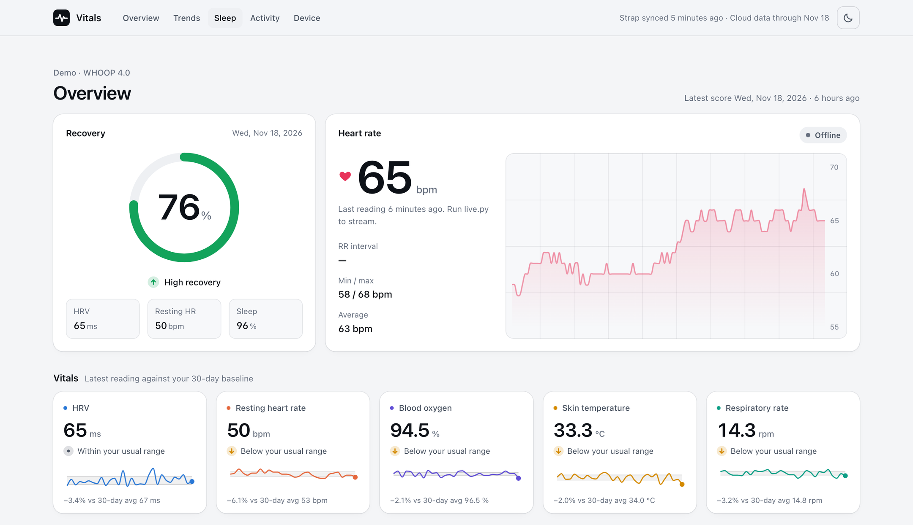
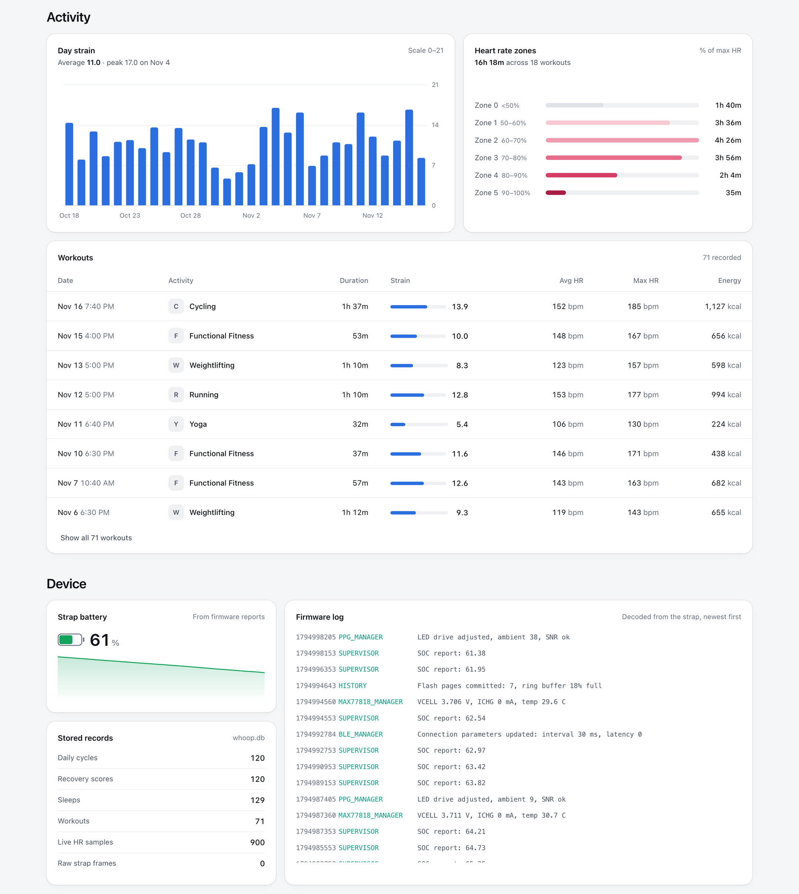

# whoop-os — own your WHOOP data

A local-first system to pull your own biometrics off a **WHOOP 4.0**: live heart rate /
HRV straight off the strap over Bluetooth, your full history from the official WHOOP API,
a lightweight localhost dashboard, and automatic encrypted + cloud backups. Everything
stays on your machine.

> **Your device, your data.** This is personal interoperability and backup — not for any
> device you don't own. It's **not a medical device** (fitness/self-tracking only), it's
> reverse-engineered (a firmware update can change the protocol), and the computed scores
> (Recovery/Strain/Sleep) come from WHOOP's cloud via the API, not the strap.

## Give it to an AI (easiest path)
1. Clone this repo and open it in an AI coding agent (e.g. Claude Code) on the Mac with the
   strap nearby.
2. Point the agent at **`skills/reverse-engineer-whoop/SKILL.md`** (or copy that folder to
   `~/.claude/skills/` to make it a first-class skill), then say:
   > "Use the reverse-engineer-whoop skill to help me own my WHOOP 4.0 data."
3. The agent follows the skill: finds the strap by BLE service UUID, proves the command
   path, streams live HR, drains history, wires up the WHOOP API, and stands up the
   dashboard + backups.

## Do it yourself
```bash
cd whoop-tools
python3 -m venv .venv && .venv/bin/pip install -r requirements.txt
.venv/bin/python whoop.py selftest        # prove the protocol frame builder
.venv/bin/python live.py                  # live HR (wear the strap); Ctrl-C to stop
# official API: copy .env.example -> .env, add dev-app creds, then:
.venv/bin/python whoop_api.py login && .venv/bin/python whoop_api.py sync
.venv/bin/python dashboard.py             # http://localhost:8787
```
Full setup, backups, and the hourly background service are in **`whoop-tools/README.md`**.

## Preview with demo data (fill-in template)
This repo ships **synthetic demo data only** — a fictional "Demo User", no real person's
biometrics. See the dashboard populated before connecting anything:
```bash
cd whoop-tools
.venv/bin/python seed_demo.py                              # (re)generate data/whoop-demo.db
WHOOP_DB=data/whoop-demo.db .venv/bin/python dashboard.py  # http://localhost:8787
```
When you run the real pipeline it creates your **own** `whoop.db` (gitignored) and fills it
from your strap + API. The demo DB is just the template so you know what "done" looks like.

## The dashboard
A single offline page (`whoop-tools/static/`, vendored Chart.js, light/dark theme) with six
sections: **Overview** (today's recovery ring + live heart-rate monitor), **Vitals** (HRV,
resting HR, SpO₂, skin temp, respiratory rate vs. your 30-day baseline), **Trends**
(recovery, HRV, resting HR over 30D/90D/6M/1Y), **Sleep** (last night's stages + nightly
stage history), **Activity** (day strain, heart-rate zones, workouts) and **Device**
(strap battery, stored record counts, decoded firmware log). Screenshots below use the
synthetic demo data:





## What's here
- `whoop-tools/` — the working system (BLE protocol, live stream, API sync, decode,
  dashboard, encrypted backups, Cloudflare D1 sync, launchd services).
- `skills/reverse-engineer-whoop/` — a portable skill + `resources/PROTOCOL.md`
  (verified protocol + command table) and `resources/WALKTHROUGH.md` (the end-to-end path).

## Architecture
```
 WHOOP 4.0 strap ──BLE──►  whoop.py / live.py / collector.py ─┐
 WHOOP API (OAuth) ──────►  whoop_api.py ─────────────────────┤──►  SQLite (whoop.db)
                                                              │        │
                                      decode.py (raw→tables) ─┘        ├─► dashboard.py (localhost)
                                                                       ├─► backup.py (encrypted local)
                                                                       └─► cloud_sync.py (Cloudflare D1)
```
