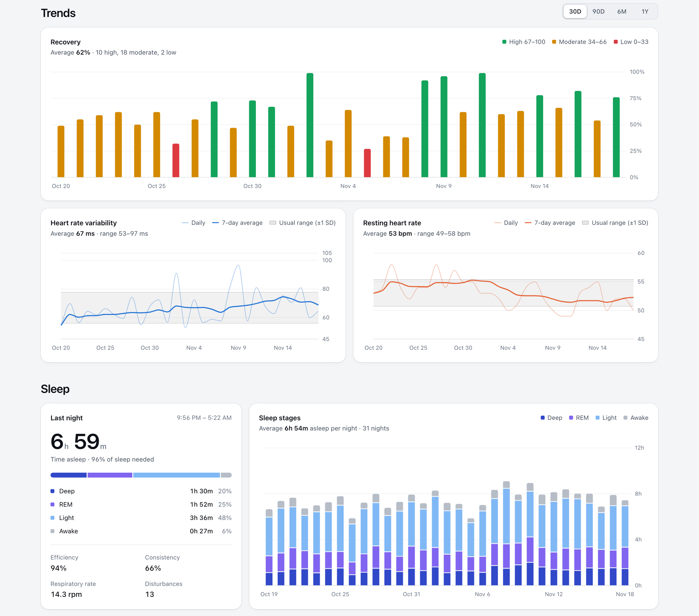

# OpenVitals — own your wearable data

A local-first system to pull your own biometrics off your wearable. It currently supports the
**WHOOP 4.0**: live heart rate /
HRV straight off the strap over Bluetooth, your full history from the official WHOOP API,
a lightweight localhost dashboard, and automatic encrypted + cloud backups. Everything
stays on your machine.

> **Your device, your data.** This is personal interoperability and backup — not for any
> device you don't own. It's **not a medical device** (fitness/self-tracking only), it's
> reverse-engineered (a firmware update can change the protocol), and the computed scores
> (Recovery/Strain/Sleep) come from WHOOP's cloud via the API, not the strap.
>
> OpenVitals is an independent project. It is not affiliated with, endorsed by, or sponsored
> by WHOOP, Inc. "WHOOP" is a trademark of WHOOP, Inc. and is used here only to name the
> device the software works with.

## Give it to an AI (easiest path)
1. Clone this repo and open it in an AI coding agent (e.g. Claude Code) on the Mac with the
   strap nearby.
2. Point the agent at **`skills/reverse-engineer-whoop/SKILL.md`** (or copy that folder to
   `~/.claude/skills/` to make it a first-class skill), then say:
   > "Use the reverse-engineer-whoop skill to help me own my WHOOP 4.0 data."
3. The agent follows the skill: finds the strap by BLE service UUID, proves the command
   path, streams live HR, drains history, wires up the WHOOP API, and stands up the
   dashboard + backups.

## Do it yourself
```bash
cd whoop-tools
python3 -m venv .venv && .venv/bin/pip install -r requirements.txt
.venv/bin/python whoop.py selftest        # prove the protocol frame builder
.venv/bin/python daemon.py                # hold the strap while it's nearby: drain + live HR; Ctrl-C to stop
# official API: copy .env.example -> .env, add dev-app creds, then:
.venv/bin/python whoop_api.py login && .venv/bin/python whoop_api.py sync
.venv/bin/python dashboard.py             # http://localhost:8787
```
Full setup, backups, and the always-on background service are in **`whoop-tools/README.md`**.

The strap records one sample a second on its own. `daemon.py` connects whenever the strap
is near the laptop, collects what it stored while you were away, and streams live in
between, so the heart-rate record has no gaps even though the laptop is not always there.

## Preview with demo data (fill-in template)
This repo ships **synthetic demo data only** — a fictional "Demo User", no real person's
biometrics. See the dashboard populated before connecting anything:
```bash
cd whoop-tools
.venv/bin/python seed_demo.py                              # (re)generate data/whoop-demo.db
WHOOP_DB=data/whoop-demo.db .venv/bin/python dashboard.py  # http://localhost:8787
```
When you run the real pipeline it creates your **own** `whoop.db` (gitignored) and fills it
from your strap + API. The demo DB is just the template so you know what "done" looks like.

## The dashboard
A local, offline app (`whoop-tools/static/`, vendored Chart.js, light/dark theme):

- **Heart** (full screen, the landing view): a 3D heart that beats on the strap's real beat
  timing, metric callouts tied to the mesh, an exploded mode (`E`), full screen (`F`),
  drag to rotate, a live pulse strip and a timeline.
- **Today**: only what the strap recorded today (live monitor, heart rate over the day,
  daytime HRV from RR intervals), compared against your archive baseline.
- **Archive**: WHOOP cloud history behind a calendar. Every page is labelled with the day
  you're viewing: recovery, vitals, trends, sleep, activity and workouts for that day.
- **Device**: strap battery, **heart rate coverage** per day (how much of the day has heart
  rate, how much is still on the strap, and why the longest gap is there), stored record
  counts, decoded firmware log, and a **Resync** button that runs one collector cycle (or asks
  the running daemon to drain now).

## Keeping coverage high
Strain, Sleep and Recovery are only shown when the strap recorded enough of the day (85%) or
night. The morning Telegram message says when strain was held back and where the biggest
gap was. How the data gets in:

- The strap records every second on its own, worn or not near the Mac, and keeps days of
  it (the exact capacity is not measured yet). When the Mac sees the strap again, the daemon reads everything stored and fills the
  gaps. So **the Mac being asleep or you being out of range does not lose data**; it only
  delays it until the next connection.
- What does lose data:
  - **The strap is off your wrist or charging.** It records nothing then. Charge it while
    you sit at the desk (about an hour), not overnight or while you are out.
  - **Another app reads the strap first.** The WHOOP phone app (or any second copy of this
    daemon) takes the stored history and the strap then deletes it. Log out of the WHOOP app
    on your phone, or turn its Bluetooth off, and run only one daemon.
  - **The strap's memory fills up.** That takes days away from the Mac. Open the Mac near
    the strap at least once every couple of days.
- What makes data arrive sooner (so the morning message and today's numbers are complete):
  - Keep the Mac within about 10 m of the strap: the bedroom at night is ideal.
  - Plugged in, let the Mac stay awake with the screen off: System Settings > Battery >
    Options > "Prevent automatic sleeping on power adapter when the display is off" (or run
    `caffeinate -s` in a terminal). Leave the lid open: a closed lid puts a MacBook to sleep
    unless an external display is attached.
  - Leave Bluetooth on. After a wake the daemon reconnects by itself (and restarts itself if
    macOS Bluetooth is stuck), usually within two minutes.
- The Device page shows each day's coverage. "Still on the strap" means it will fill in at
  the next sync; "nothing stored" means the strap was off your wrist, charging, or another
  app read it.

Screenshots below use the synthetic demo data:





## Do it yourself with an agent
Point your coding agent (Claude Code, Codex, Cursor) at
[`skills/reverse-engineer-whoop/SKILL.md`](skills/reverse-engineer-whoop/SKILL.md). It walks
from a blank machine to a running system in seven phases, each with a "done when" check, and
`skills/reverse-engineer-whoop/scripts/doctor.py` tells it what's done and what's next.
Setup, protocol, data model, dashboard, troubleshooting and the optional Cloudflare backup
are in `skills/reverse-engineer-whoop/resources/`.

## What's here
- `whoop-tools/` — the working system (BLE protocol, always-on daemon, API sync, decode,
  dashboard, encrypted backups, Cloudflare D1 sync, launchd services).
- `whoop-tools/templates/` + `import_data.py` — **device adapter**: no WHOOP 4.0? Fill the
  CSV templates from any wearable's export (Oura, Garmin, Apple Health, Fitbit…) and import
  them into the same dashboard. Mapping guide + agent prompt in `templates/README.md`.
- `skills/reverse-engineer-whoop/` — a portable skill + `resources/PROTOCOL.md`
  (verified protocol + command table) and `resources/WALKTHROUGH.md` (the end-to-end path).

## Architecture
```
 WHOOP 4.0 strap ──BLE──►  whoop.py / daemon.py ───────────────┐
 WHOOP API (OAuth) ──────►  whoop_api.py ─────────────────────┤──►  SQLite (whoop.db)
                                                              │        │
                                      decode.py (raw→tables) ─┘        ├─► dashboard.py (localhost)
                                                                       ├─► backup.py (encrypted local)
                                                                       ├─► cloud_sync.py (Cloudflare D1)
                                                                       └─► archive.py (raw frames → Cloudflare R2, then removed locally)
```
