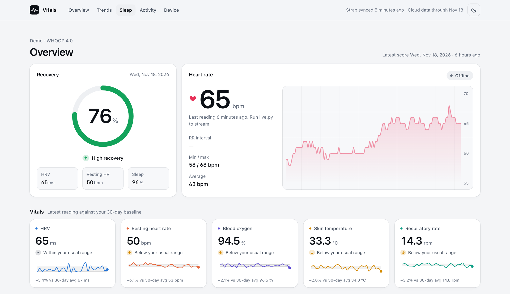

# whoop-local

Your own local WHOOP data system. No cloud, no subscription dependency for the raw
signals; everything lives in `whoop.db` on your Mac.

**Two data sources → one SQLite DB → localhost dashboard**

1. **Strap over BLE** (reverse-engineered WHOOP 4.0 protocol) — live HR + RR (HRV),
   and a lossless capture of the historical drain. Files: `whoop.py`, `collector.py`.
2. **Official WHOOP API v2 (OAuth)** — Recovery, HRV, resting HR, SpO₂, skin temp,
   Sleep stages, Strain, workouts. File: `whoop_api.py`.

## One-time setup

```bash
cd whoop-tools
# 1. Create your WHOOP developer app at https://developer.whoop.com
#    Redirect URI MUST be exactly: http://localhost:8765/callback
#    Scopes: recovery, cycles, sleep, workout, profile, body measurement, offline
cp .env.example .env            # then paste your Client ID + Secret into .env
.venv/bin/python whoop_api.py login     # opens browser once, stores refresh token
.venv/bin/python whoop_api.py sync      # pulls your history into whoop.db
```

## Preview with synthetic demo data (no real biometrics)
```bash
.venv/bin/python seed_demo.py                              # generates data/whoop-demo.db (fictional)
WHOOP_DB=data/whoop-demo.db .venv/bin/python dashboard.py  # http://localhost:8787
```
The real pipeline creates your own `whoop.db` (gitignored). Never commit a real `whoop.db`
or its exports — `.gitignore` blocks `*.db`, `data/`, `.env`, `.tokens.json`, `.backup_key`.

## Daily use

```bash
# one collection cycle (strap drain + 20s live HR + API sync):
.venv/bin/python collector.py --live 20

# dashboard:
.venv/bin/python dashboard.py           # http://localhost:8787
```


## Run it automatically in the background (hourly)

The plists contain a `__WHOOP_TOOLS_DIR__` placeholder. Fill in the absolute path of
this folder while copying them (run from inside `whoop-tools/`):
```bash
sed "s|__WHOOP_TOOLS_DIR__|$PWD|g" com.whoop.collector.plist > ~/Library/LaunchAgents/com.whoop.collector.plist
launchctl load ~/Library/LaunchAgents/com.whoop.collector.plist
# logs: collector.out.log / collector.err.log
# to stop: launchctl unload ~/Library/LaunchAgents/com.whoop.collector.plist
```
It wakes every hour, syncs the API, and—if the strap is in Bluetooth range—drains
any new stored data. Close the official WHOOP phone app while it syncs (the strap
bonds to one device at a time).

## Backups
- **Local:** every collector run writes a timestamped snapshot to `backups/` (`.db` + JSON + CSV),
  AES-256 encrypted with `.backup_key` if present. Keeps the last 30. Restore with:
  `.venv/bin/python backup.py decrypt backups/whoop-YYYYMMDD-HHMMSS.json.enc out.json`
  **Keep a copy of `.backup_key`** — without it the encrypted backups can't be opened.
- **Cloud (Cloudflare D1):** add `CF_API_TOKEN` to `.env` (token with Account > D1 > Edit)
  and `CF_D1_DATABASE_ID` (create a D1 database, e.g. `whoop-backup`, in your Cloudflare account),
  then `.venv/bin/python cloud_sync.py` pushes everything to it. Runs
  automatically each collector cycle once the token is set.

## Always-on services (launchd)
- `com.whoop.collector` — hourly: strap drain + live HR + API sync + decode + backup + cloud push
- `com.whoop.dashboard` — keeps `http://localhost:8787` up (auto-restarts)
```bash
# from inside whoop-tools/ (the placeholder becomes this folder's absolute path)
for p in com.whoop.collector com.whoop.dashboard; do
  sed "s|__WHOOP_TOOLS_DIR__|$PWD|g" $p.plist > ~/Library/LaunchAgents/$p.plist
done
launchctl load ~/Library/LaunchAgents/com.whoop.collector.plist
launchctl load ~/Library/LaunchAgents/com.whoop.dashboard.plist
```

## Files
| File | Role |
|---|---|
| `whoop.py` | WHOOP 4.0 BLE protocol (frames, CRCs, parsers) + CLI (`info`/`live`/`drain`) |
| `db.py` | SQLite schema + helpers |
| `whoop_api.py` | OAuth2 + v2 API sync |
| `decode.py` | decode raw strap frames → realtime HR, battery SOC, firmware logs |
| `collector.py` | background collector (BLE drain + live + API + decode + backup + cloud) |
| `backup.py` | encrypted local snapshots (+ `decrypt`) |
| `cloud_sync.py` | push to Cloudflare D1 over REST |
| `dashboard.py` + `static/` | localhost dashboard: Flask JSON API + static page (vendored Chart.js, offline) |
| `seed_demo.py` | generates a synthetic demo DB (fictional "Demo User") for previews |
| `history_*.ndjson` / `ble_raw` | lossless raw strap frames for future deeper decoding |

## Notes / honesty
- Reverse-engineered personal tool, **not a medical device**. Good for fitness and
  self-tracking; don't use for clinical decisions.
- A WHOOP firmware update could change the BLE protocol; the API is the stable path.
- Recovery/Strain/Sleep scores come from the **API** (WHOOP computes them in-cloud);
  the strap gives the raw signals those are derived from.
- Apple Health can't be read/written from macOS (HealthKit is iOS-only). To fold in
  existing Health history, export it from the iPhone Health app and parse the XML.
